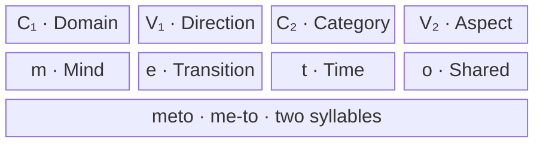

# The Hamo Language

**A small vocabulary. A structured way to build meaning.**

*Hamo* — “The living breath of complete shared mind.”

Hamo is an experimental constructed language designed to express rich ideas through compact, pronounceable forms. Its central idea is that the sounds inside a word can carry reusable semantic cues: a domain, a direction, a category, and an aspect.

The ambition is simple: **communicate more meaning with less effort.** Hamo pursues this through two-syllable words, systematic composition, and a core vocabulary of approximately 120 words.

[Word architecture](#word-architecture) · [Examples](#hamo-in-use) · [Efficiency](#where-the-efficiency-comes-from) · [Evaluation](#measuring-real-efficiency)

## Design principles

| Principle | Design approach | Intended benefit |
| :--- | :--- | :--- |
| **Ease of speech** | Simple consonant–vowel syllables; an accessible sound inventory | Fluid pronunciation with few articulatory obstacles |
| **Semantic density** | Four positions contribute different kinds of meaning | Compact words for concepts that may require a longer explanation |
| **Systematic composition** | Reuse a small core vocabulary across combinations | Extend expression without memorizing a separate word for every idea |
| **Predictability** | Give each position a consistent semantic role | Help learners recognize patterns and interpret unfamiliar forms |

These are design goals. Ease of pronunciation must be tested with speakers from different language backgrounds; no sound inventory is assumed to be universally effortless.

## Word architecture

Hamo’s full-word template is:

$$
\mathrm{Word}=C_1V_1C_2V_2
$$

The two consonant–vowel units form two syllables: **C₁V₁ · C₂V₂**.

| Position | Semantic role | Question it helps answer | In **meto** |
| :---: | :--- | :--- | :--- |
| **C₁** | Primary domain | What is this about? | **m** — mind / thought |
| **V₁** | Vector or direction | How does it move or change? | **e** — flow / transition |
| **C₂** | Secondary category | What additional dimension matters? | **t** — time / duration |
| **V₂** | State or aspect | In what condition or mode? | **o** — wholeness / shared |

### Inside a word: **meto**

**Semantic cues:** mind + transition + time + shared wholeness.

**Intended interpretation:**

> “The shared, ongoing process of growing in wisdom together across time.”

This illustrates the design’s ambition: a compact form can invoke a rich, shared concept. The dictionary and composition rules must make that interpretation recoverable; the length of its English explanation alone does not demonstrate compression.

**Short forms:** The examples also use **mi** and **li**, which follow a shorter CV pattern. This README distinguishes those forms from the full CVCV template. Their status as grammatical exceptions still needs to be formalized in the specification.

## Hamo in use

| Hamo | Word-by-word gloss | Intended English reading |
| :--- | :--- | :--- |
| **Kora li hawa wako?** | question · you · eat · food | “Are you eating food?” |
| **Mi tami peko kepo.** | I · past · work · good | “I worked well.” / “I did a good job.” |
| **Milo taki sera nuka.** | we · future · travel · home | “We will journey home.” |

### Start with these forms

| Function | Forms shown in the examples |
| :--- | :--- |
| People | **mi** — I; **li** — you; **milo** — we |
| Time | **tami** — past; **taki** — future |
| Questions | **kora** — question marker |
| Actions | **hawa** — eat; **peko** — work; **sera** — travel |
| Other concepts | **wako** — food; **kepo** — good; **nuka** — home |

These examples demonstrate intended readings. A complete grammar must specify word order, tense and aspect, modifier scope, and how the same forms behave in other sentences.

## Where the efficiency comes from

### 1. Compact forms with reusable meaning

A full CVCV word uses four positions and two syllables. Each position contributes a cue, so the learner can potentially reuse knowledge of the system across many words.

The benefit depends on **predictability**: readers and listeners must recover the intended concept reliably. A short word with an unclear interpretation may require more explanation than a longer one.

### 2. A small vocabulary with many combinations

If a vocabulary contains 120 words, the number of ordered sequences of exactly *n* words is:

$$
N(n)=120^n
$$

| Sequence length | Raw possible sequences |
| :--- | ---: |
| 1 word | 120 |
| 2 words | 14,400 |
| 3 words | 1,728,000 |

This calculation permits repetition and treats word order as significant. It counts possible strings, **not distinct, grammatical, or unambiguous meanings**. The grammar and lexicon determine how many combinations are useful. Combinatorial growth is available to any vocabulary; Hamo’s intended contribution is making its combinations systematic and learnable.

### 3. Shared definitions reduce repeated explanation

Once speakers share a concept and its word, they can invoke it without explaining it from scratch each time. Hamo aims to make those definitions easier to organize through its semantic architecture.

That creates a practical tradeoff: compact communication requires an initial investment in learning the vocabulary and rules. Learning time belongs in the evaluation alongside message length.

## Measuring real efficiency

A useful evaluation asks whether a listener recovers the intended meaning, how long that takes, and how much training was required.

| Dimension | What to measure |
| :--- | :--- |
| **Compactness** | Letters and spoken syllables for matched messages |
| **Comprehension** | Recovery of intended facts and relationships, using a predefined scoring rubric |
| **Communication time** | Time from the start of the message to the listener’s completed interpretation, including clarification |
| **Learnability** | Training time, vocabulary retention, and performance on unfamiliar combinations |
| **Speech reliability** | Recognition errors across speakers, accents, and listening conditions |

One proposed operational score for a fixed test set is:

$$
E=\frac{\sum_{i=1}^{m}r_i}{\sum_{i=1}^{m}t_i}
$$

Here, **rᵢ** is the fraction of the intended meaning recovered for message *i* (from 0 to 1), and **tᵢ** is its total communication time in seconds. With equally weighted messages, the score measures recovered message equivalents per second. It is a proposed evaluation metric, not a measured result or a universal measure of language quality.

To compare Hamo with another language:

1. Use the same held-out messages, tasks, background knowledge, and available context.
2. Include everyday exchanges and complex ideas; avoid selecting only concepts with unusually long English explanations.
3. Record training time and proficiency so differences in familiarity remain visible.
4. Score interpretations against a predefined rubric, ideally with independent raters.
5. Report comprehension, time, and learning cost separately, alongside any combined score.

**Evidence of an advantage would be lower communication cost at comparable comprehension, with the required learning investment made explicit.**

---

**Hamo explores how much shared understanding a small, structured language can carry.**

*Rendering note: the diagrams use Mermaid. The accompanying tables preserve the same information in Markdown viewers without diagram support.*
